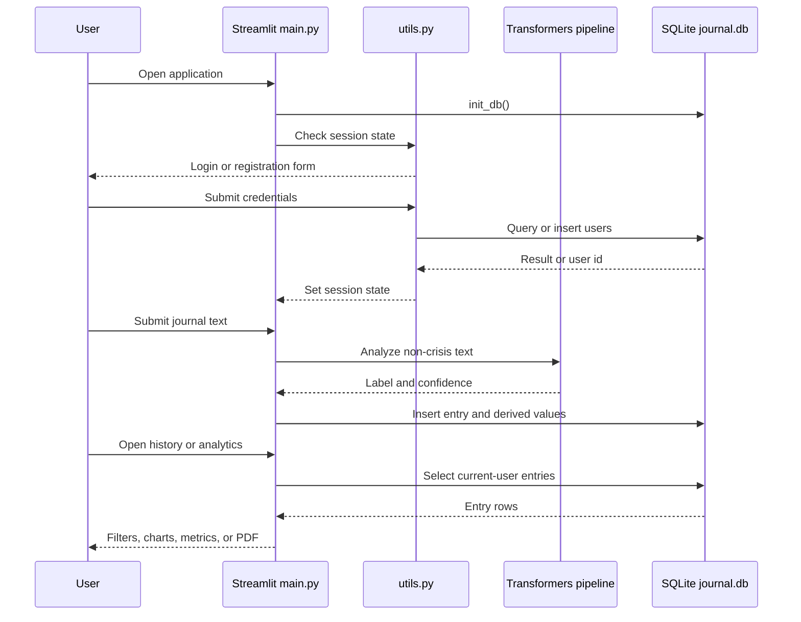
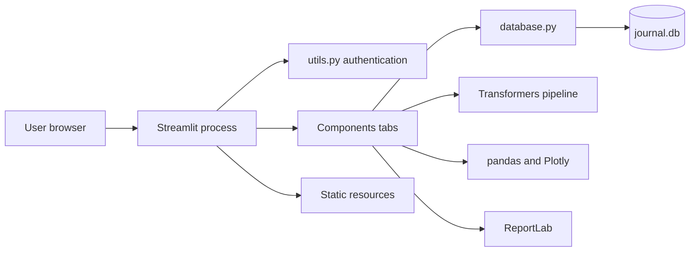

# Project Overview

MindCare is a Streamlit mental-health journaling application. A user creates an account, signs in, writes a dated journal entry, and receives a sentiment classification from a local Hugging Face Transformers pipeline. Entries are stored in SQLite and can later be searched, filtered, visualized, and exported as a PDF. Crisis keywords trigger a warning and resource guidance. The repository appears to be an early-stage portfolio or MVP application rather than a production service: it has a coherent end-to-end workflow, but no automated tests, migrations, CI/CD, monitoring, or production-grade identity and secret handling.

## 1. Executive Summary

The main workflow is registration, login, journal entry, classification, persistence, and review. `main.py` initializes SQLite, checks Streamlit session state, loads the model, and renders four tabs. `database.py` owns table creation and entry queries. The components own the UI workflows, while `utils.py` contains authentication, model loading, sidebar content, and PDF generation.

The application uses a single-process modular-monolith design. SQLite is accessed directly through Python's `sqlite3` module. Model inference runs synchronously during the Save Entry interaction. This is easy to run locally and appropriate for an MVP, but UI, business workflow, persistence, and error display are tightly coupled. The README's claim of emotion tracking should be interpreted carefully: the configured default `pipeline("sentiment-analysis")` produces sentiment labels, which the application stores and displays as emotion.

The strongest aspect is a complete vertical slice: registration, journaling, analysis, persistence, history, analytics, resource guidance, and PDF export are connected. The most important limitations are plaintext password storage, weak crisis detection, lack of durable settings, disabled XSRF/CORS protections in the devcontainer command, no tests, and synchronous inference/database work that would be difficult to scale. There are no verified clinical or production claims in the repository.

## 2. Problem Statement

MindCare reduces the friction of keeping a personal journal and noticing patterns over time. Without it, a user could use paper or a generic notes application, but would need to search manually and interpret trends themselves. MindCare combines journaling with coarse automated classification and visual history so a user can reflect on recurring positive, neutral, or negative patterns.

The repository assumes users are comfortable entering private reflections into a browser application and that a broad sentiment signal is useful as a reflection aid. It does not implement diagnosis, therapist review, emergency intervention, or clinical decision support. The intended user and product scope are inferred from the UI and README; no product specification or user research is included.

## 3. Target Users and Use Cases

### Verified or directly visible

- A user registers, signs in, writes an entry for a selected date, and logs out.
- The application classifies an entry as positive, negative, neutral, or crisis and stores the result.
- A user searches history by text and filters it by sentiment.
- A user views a sentiment trend, emotion distribution, total entries, positive days, current streak, and average confidence.
- A user exports retrieved entries to PDF.
- A user views Indian helplines and self-care suggestions.

### Strongly inferred

- An individual uses the app for private self-reflection and returns to review broad patterns.
- The app is an MVP or portfolio project rather than a clinician or administrator platform.

There is no verified admin, clinician, collaboration, sharing, moderation, or support workflow.

## 4. Core User Journey

1. Streamlit starts `main.py`; `init_db()` creates `users`, `entries`, and `user_settings` if absent.
2. `check_authentication()` initializes `st.session_state`. An unauthenticated user sees `login_section()`.
3. Registration calls `create_user()` in `utils.py`; login calls `verify_user()`. Successful login stores the user id and username in session state and reruns the app.
4. `main()` loads the Transformers pipeline. If it fails, the UI reports the problem and journal entries use a neutral fallback.
5. `journal_tab.py` accepts a date and text. Empty text is rejected. Six lower-case crisis phrases are checked first; otherwise the model runs synchronously.
6. `add_user_entry()` stores the text, model label, broad sentiment, and confidence against the current user id.
7. `history_tab.py` loads the user's entries, filters them in Python, and can pass them to `create_pdf()`.
8. `analytics_tab.py` converts the rows to pandas and renders Plotly charts and summary metrics.
9. Settings displays logout, reminder controls, static resources, and a random self-care suggestion. Reminder controls do not write to `user_settings`.



## 5. Feature Breakdown

| Feature | Status | Evidence and limitation |
| --- | --- | --- |
| Registration/login | Implemented, insecure for production | `utils.py` inserts and verifies credentials, but passwords are plaintext and there is no rate limiting, expiry, recovery, or MFA. |
| Journal creation | Implemented | Date and text are saved. The mood slider is displayed but its value is discarded. |
| Sentiment analysis | Implemented with fallback | The default Transformers sentiment pipeline runs synchronously; model failure falls back to neutral. |
| Emotion display | Partial | A sentiment label is stored in the `emotion` field; no verified multi-emotion model is configured. |
| Crisis detection | Basic heuristic | Six phrases produce a crisis record and warning; there is no validated classifier or escalation workflow. |
| History | Implemented | Search and sentiment filtering happen after all rows are loaded into Python. |
| Analytics | Implemented | Plotly charts and metrics use stored sentiment/emotion/confidence, not the unused mood score. |
| PDF export | Implemented with error handling | ReportLab generates a document, but raw entry text is inserted as markup without escaping. |
| Reminders/settings | UI-only | `user_settings` exists, but no read/write or scheduler exists. |
| Resources | Static content | Helplines and self-care content are hard-coded and need review/ownership. |

## 6. Technology Stack

| Layer | Technology | Where Used | Why It Fits | Trade-Offs |
| --- | --- | --- | --- | --- |
| UI/runtime | Streamlit | `main.py`, `Components/` | Fast interactive Python UI with forms, charts, and downloads. | Rerun state and UI-coupled logic make APIs and independent frontend tests harder. |
| Language | Python 3.11 | Devcontainer and all modules | Strong data/ML ecosystem and low prototype ceremony. | Dependencies are not locked and runtime behavior is not packaged for production. |
| Database | SQLite/sqlite3 | `database.py`, `utils.py` | Zero-server setup for local/small-user use. | File persistence, write concurrency, migrations, backups, and replicas are weak points. |
| Model | Transformers/PyTorch | `utils.load_model`, `journal_tab.py` | Off-the-shelf local inference. | Startup/memory/latency costs, version drift, and no visible evaluation set or model pin. |
| Analysis | pandas | `analytics_tab.py` | Simple row transformation and aggregation. | Complete histories are loaded in memory on reruns. |
| Charts | Plotly | `analytics_tab.py` | Interactive charts integrated with Streamlit. | Does not solve aggregation or semantic validity. |
| Export | ReportLab | `utils.create_pdf` | Direct PDF generation without another service. | Needs escaping, pagination tests, and large-export handling. |
| Development | Dev Containers | `.devcontainer/devcontainer.json` | Consistent Python environment and port forwarding. | Development config is not production infrastructure; security flags are weakened. |

## 7. High-Level Architecture

This is a modular monolith in one Streamlit process. `main.py` owns page setup, initialization, authentication gating, model loading, and tab composition. `Components/` renders tabs and calls shared functions. `database.py` owns schema and entry persistence. `utils.py` mixes auth, Streamlit rendering, model loading, and document generation. No queue, worker, hosted database, object store, remote API, or monitoring component is configured.



## 8. Module and Folder Map

| Path | Responsibility | Important Notes |
| --- | --- | --- |
| `main.py` | Page setup and composition | Initializes DB, gates access, loads model, renders tabs. |
| `utils.py` | Auth, model loading, sidebar, PDF | Broad utility module mixing UI and data concerns. |
| `auth.py` | Duplicate auth implementation | Similar functions exist here, but `main.py` imports auth from `utils.py`. |
| `database.py` | SQLite schema and entry queries | No migrations, update/delete, or retention operations. |
| `Components/journal_tab.py` | Entry, crisis check, model, feedback | Mood value is unused; analysis is synchronous. |
| `Components/history_tab.py` | History filters and PDF | Fetches all current-user rows first. |
| `Components/analytics_tab.py` | Charts and statistics | Recomputes from all rows on render. |
| `Components/settings_tab.py` | Logout, resources, reminder UI | Reminder settings are not persisted or scheduled. |
| `.devcontainer/devcontainer.json` | Development setup | Starts Streamlit with CORS and XSRF protection disabled. |
| `journal.db` | Runtime SQLite data | At inspection: one user, three entries, no settings rows. |
| `requirements.txt` | Dependency declarations | Minimum versions, no lock file. |

Read `main.py`, `journal_tab.py`, `database.py`, `utils.py`, then the remaining tabs to understand the project quickly.

## 9. Data Model

`users` has an integer id, unique username, and password text. `entries` has an id, user id, date text, original entry text, emotion, sentiment, and confidence. `user_settings` has one possible row per user, a reminder flag, and reminder time. Dates are `YYYY-MM-DD` strings. There is no mood column, created timestamp, updated timestamp, model version, analysis status, crisis-event record, or deletion/archival behavior. Foreign-key declarations exist, but the code does not visibly enable `PRAGMA foreign_keys = ON`.

```mermaid
erDiagram
    USERS ||--o{ ENTRIES : owns
    USERS ||--o| USER_SETTINGS : has
    USERS { integer id PK; text username UK; text password }
    ENTRIES { integer id PK; integer user_id FK; text date; text entry_text; text emotion; text sentiment; real confidence }
    USER_SETTINGS { integer user_id PK, FK; boolean daily_reminder; text reminder_time }
```

The lifecycle is insert and read only. The UI has no edit or delete operation. Raw journal text is sensitive personal data stored beside derived model output.

## 10. API and Interface Design

There is no HTTP API. The interface is Streamlit's widget and rerun model. The main internal operations are `init_db()`, `create_user()`, `verify_user()`, `get_user_entries()`, and `add_user_entry()`, plus the four tab functions. SQL values use parameter placeholders, which is a good basic defense against SQL injection in visible queries. Validation is minimal: empty journal text and mismatched confirmation are handled, but usernames, password strength, input size, pagination, versioning, idempotency, and rate limiting are absent. History and analytics retrieve all rows for a user and process them in memory.

## 11. Authentication and Authorization

Identity is established by matching submitted credentials in SQLite. The user id and username are stored in Streamlit session state. Entry queries receive the current session's user id, so the intended ownership boundary is per-user reads and writes. Logout clears the two session values and reruns.

The critical failure is plaintext password storage. There is no session expiry, secure cookie/session configuration visible here, CSRF design, login throttling, recovery, email verification, or audit logging. Authorization is implicit rather than a reusable policy layer. The devcontainer also runs with `--server.enableCORS false --server.enableXsrfProtection false`; those flags may be convenient locally but require a deliberate threat model for any public deployment.

## 12. Important Engineering Decisions

### Streamlit instead of a separate frontend/backend

**Evidence:** Every UI and workflow module uses Streamlit APIs. **Likely reason:** Fast delivery in one language. **Benefit:** Little ceremony and direct ML/data integration. **Cost:** Rerun/session coupling and difficult independent testing/scaling. **Alternative:** FastAPI plus a web client when multiple clients, stronger identity, or background work are required. **Reconsider when:** API contracts or independent scaling become real requirements.

### SQLite instead of a server database

**Evidence:** `database.py` opens `journal.db` directly. **Likely reason:** Zero setup for a small app. **Benefit:** Easy local transactions. **Cost:** File deployment, write contention, no migrations, and weak replica support. **Alternative:** PostgreSQL with migrations and managed backups. **Reconsider when:** Concurrent writers, replicas, or operational recovery matter.

### Synchronous model inference

**Evidence:** `journal_tab.py` calls the pipeline before `add_user_entry()`. **Likely reason:** Immediate result without a queue. **Benefit:** Simple user flow. **Cost:** Model latency/failure can block saving. **Alternative:** Save with pending status and process with a worker. **Reconsider when:** Measured latency or traffic makes interactive inference unreliable.

### Keyword crisis heuristic

**Evidence:** Six phrases are checked before model inference. **Likely reason:** Cheap deterministic safety cue. **Benefit:** Obvious phrases receive an immediate warning. **Cost:** False negatives/positives and artificial confidence `1.0`; no escalation. **Alternative:** Reviewed, evaluated safety rules and intervention flow. **Reconsider when:** The product accepts real safety-sensitive use.

### Store derived results with entries

**Evidence:** `entries` stores emotion, sentiment, and confidence. **Likely reason:** Avoid repeated inference. **Benefit:** Fast stable history. **Cost:** No model/version provenance, so results become hard to audit. **Alternative:** Add analysis metadata or a related analysis table. **Reconsider when:** Models change or reprocessing is needed.

### Python-side filtering and analytics

**Evidence:** `get_user_entries()` returns all selected rows and tabs filter/aggregate locally. **Likely reason:** Concise for small data. **Benefit:** Simple reuse for charts and export. **Cost:** Memory and rerun time grow with history. **Alternative:** Indexed, paginated SQL queries and aggregates. **Reconsider when:** Dataset-size measurements show noticeable latency.

### Static crisis resources

**Evidence:** Resources are hard-coded in `utils.py` and `settings_tab.py`. **Likely reason:** No network dependency. **Benefit:** Available when external services are down. **Cost:** Stale content and limited localization. **Alternative:** Versioned, reviewed resource data with ownership. **Reconsider when:** Users span regions or resource accuracy is operationally critical.

## 13. Reliability and Failure Handling

Model import/load and PDF import/generation failures are caught and shown in Streamlit. Empty entries and duplicate usernames get friendly messages. SQLite connections are usually closed and inserts commit explicitly. However, there are no explicit database exception handlers, model timeout/retry policy, transaction spanning analysis and persistence, or recovery state. A model failure can prevent a valid entry from being saved, and a neutral fallback can look like a real neutral result. PDF generation can fail on malformed markup or unexpected dates. There is no structured logging, alerting, backup recovery, or user-visible analysis status.

## 14. Performance and Scalability

Likely costs are model startup/inference, Streamlit reruns, full-history reads, pandas chart construction, and synchronous PDF generation. `load_model()` has no visible cache decorator. At larger history sizes, Python-side filtering and analytics grow in memory and time. At higher concurrency, SQLite write contention and model memory become important. Horizontal scaling is constrained by the local database file. No benchmarks exist, so measure model load/inference latency, save latency, query time by row count, export time, and memory before optimizing. Likely first improvements are model caching, input limits, pagination, indexes on `(user_id, date)`, SQL aggregates, and eventually asynchronous analysis.

## 15. Security and Privacy Review

### Observed issues

- Passwords are stored and compared in plaintext.
- Devcontainer startup disables XSRF protection and CORS.
- Journal text has no documented retention, deletion, encryption, access audit, or privacy policy.
- There is no login throttling, password policy, lockout, recovery, MFA, or expiry.
- PDF export includes username, raw entries, and model results without redaction controls.
- `create_pdf()` inserts entry text into ReportLab `Paragraph` markup without escaping.
- Minimum dependency versions and no lock file weaken reproducibility and vulnerability management.

### Recommended safeguards

Use Argon2id/bcrypt, secure expiring sessions, TLS, CSRF/XSRF protection, throttling, input limits, tested ownership checks, privacy-safe logs, encrypted managed storage, deletion/retention rules, dependency scanning, and reviewed resource content. No exploit instructions are needed: these gaps are directly visible in the implementation.

## 16. Testing and Quality Strategy

No test files or test configuration were found, and no test result was verified. Unit tests should cover crisis matching, label mapping, filtering, streak calculation, PDF escaping, and auth helpers with a temporary DB. Integration tests should cover schema setup, registration/login, user isolation, entry persistence, and a fake model success/failure. Browser smoke tests should cover registration, login, save, history, analytics, export, and logout. Security tests should cover hashing, ownership, session reset, input limits, and XSRF settings.

Important cases include two users, duplicate registration, empty/very long text, casing and punctuation around crisis phrases, model import failure, database failure, markup in entries, missing settings, multiple entries per day, invalid dates, and large histories. A separate reviewed evaluation set is needed for model quality; it is not a substitute for application tests.

## 17. Deployment and Operations

The devcontainer uses Python 3.11, installs `requirements.txt`, starts Streamlit, and forwards port 8501. The README has a Streamlit Community Cloud link, but no deployment workflow, image, infrastructure-as-code, CI, migration command, backup, rollback, monitoring, health check, or alerting exists. The relative `journal.db` path is fragile in ephemeral or replicated hosting. Local development is simple; production operations are not documented.

## 18. Current Strengths

- Complete vertical workflow from authentication through persistence, analysis, review, and export.
- Parameterized SQL in visible username and entry queries.
- Current-user id is passed to entry reads rather than loading all users' entries.
- Explicit model/PDF dependency failure messages.
- Focused tab components for the main user workflows.
- Devcontainer gives a consistent Python 3.11 starting point.
- Crisis resources appear before and after login.

## 19. Current Limitations and Technical Debt

### Critical

- **Plaintext credentials:** A database compromise exposes passwords. Replace with hashing and migrate or reset existing accounts before real deployment.
- **Sensitive-data controls:** Raw mental-health text has no documented retention, deletion, encryption, or access audit.

### High

- **No automated tests:** Privacy and crisis behavior can regress unnoticed.
- **Weak crisis detection:** A six-phrase heuristic is not reliable clinical or emergency detection.
- **Disabled security protections:** Local preview flags must not become production defaults.
- **Synchronous model path:** Model failure/latency can block entry capture.

### Medium

- **Settings are not persisted:** The success message is misleading.
- **Mood rating is discarded:** The UI/schema/analytics contract is inconsistent.
- **No model provenance:** Results lack model version and analysis status.
- **In-memory history operations:** Add pagination, indexes, and database-side aggregation as data grows.
- **Duplicate auth code:** `auth.py` and `utils.py` can drift.

### Low

- Minimum dependency versions, static resource data, and random feedback reduce reproducibility and maintainability.

## 20. Production Readiness Gap

Production use requires secure credentials and sessions, TLS/XSRF protection, rate limiting, authorization tests, input limits, safe PDF escaping, privacy/retention/deletion rules, encrypted and backed-up storage, migrations, monitoring, alerts, health checks, deployment automation, dependency scanning, rollback, and resource-content ownership. Reliability needs explicit analysis statuses, timeouts, structured redacted logs, and recovery runbooks. If traffic grows, use managed relational storage and a durable worker only when measurements justify them. Cost controls are needed if inference becomes hosted or replicated.

## 21. Improvement Roadmap

### Immediate: Next 1-2 Weeks

| Improvement | Impact | Complexity | Dependency | Measure |
| --- | --- | --- | --- | --- |
| Hash passwords and migrate/reset accounts | Removes credential exposure | Medium | Account migration plan | Auth tests and no plaintext persistence |
| Add auth, ownership, crisis, persistence tests | Protects high-risk behavior | Medium | Test framework/temp DB | Repeatable test run |
| Persist mood or remove control | Aligns UI and data | Low | Product decision | Round-trip test |
| Implement or remove reminders | Removes misleading success state | Low/Medium | Scheduler decision | Settings behavior test |
| Escape/test PDF content | Makes export predictable | Low | ReportLab fixtures | Long/markup text exports |

### Near Term: Next 1-2 Months

Add migrations and indexes; cache and version the model; add analysis status; add privacy-safe structured logging; separate local and production security flags; and establish reviewed, versioned crisis resources. Measure migration safety, query time, model latency, failure rate, and error diagnosability.

### Medium Term: Next 3-6 Months

Move to managed relational/object storage if needed, introduce a durable analysis worker, add browser security/smoke tests, and establish model evaluation. Measure restore success, save latency independent of inference, workflow success, classification quality, and false crisis signals.

## 22. Metrics That Should Be Tracked

- **Product:** entries per active user, return frequency, history/analytics use, export use, and save completion.
- **Reliability:** save success, DB errors, model failures, fallback rate, PDF failures, and restart frequency.
- **Performance:** model load/inference latency, save latency, history query time, analytics render time, and PDF time.
- **Cost:** CPU/memory, model hosting, storage growth, and export volume.
- **Security:** failed logins, throttled attempts, password migration coverage, dependency findings, and ownership-test results.
- **AI quality:** precision/recall, calibration, false crisis signals, and analysis errors on a reviewed privacy-safe set.
- **Operations:** active sessions, backup/restore success, deployment duration, and rollback time.

## 23. Key Project Stories for Interviews

These are discussion frameworks, not undocumented personal history:

1. Streamlit delivered a complete data/ML MVP quickly; discuss when an API/client split becomes justified.
2. Synchronous analysis provides immediate feedback but puts model latency on Save Entry; explain a pending worker design.
3. The crisis heuristic is explainable but incomplete; discuss false negatives, evaluation, wording, and escalation.
4. SQLite is appropriate for local simplicity; explain the evidence that would trigger PostgreSQL.
5. Persisted model results avoid repeated inference but need model provenance for auditability.
6. Plaintext credentials and disabled XSRF are production blockers; explain an incremental security migration.
7. The mood/reminder UI does not match persistence; discuss contract tests and vertical feature ownership.

## 24. Facts, Inferences, and Assumptions

### Verified from the Repository

- Streamlit app with New Entry, History, Analytics, and Settings tabs.
- SQLite schema and entry access in `database.py`.
- Plaintext credential storage and matching in `utils.py`.
- Transformers sentiment pipeline with neutral fallback.
- Six-phrase crisis heuristic, history filtering, Plotly analytics, PDF export, resources, and logout.
- `user_settings` exists but is not read or written by the settings UI.
- No tests, CI, migrations, workers, or infrastructure files were found.
- Devcontainer disables CORS and XSRF protection for its startup command.
- Inspection found one user, three entries, and zero settings rows in `journal.db`.

### Strongly Inferred

- The project is an early MVP or portfolio application optimized for simple local setup.
- The primary audience is an individual rather than a clinician or administrator.
- Streamlit and SQLite were selected to minimize setup and ship a Python data/ML prototype quickly.

### Assumptions Requiring Confirmation

- Whether the linked deployment is active and matches this repository.
- Whether `journal.db` contains real data requiring privacy handling before testing.
- Which exact model the default pipeline resolves to in the target environment.
- Whether real sensitive data will ever be accepted.
- Whether helplines have been reviewed and which regions must be supported.
- The intended meaning of the mood slider and whether reminders should become real notifications.